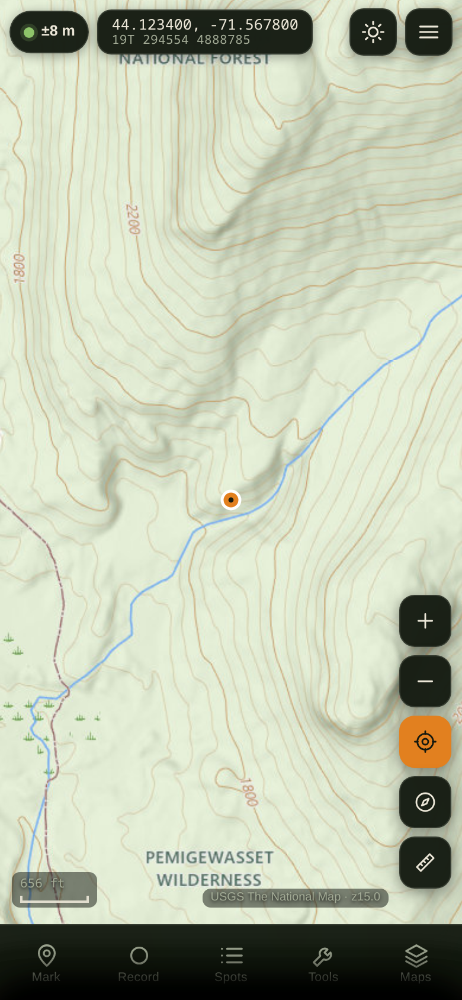
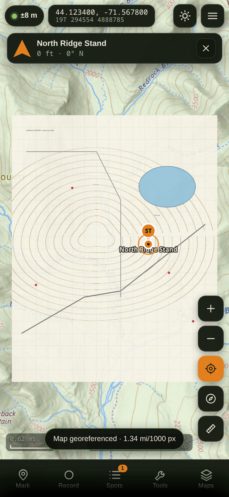
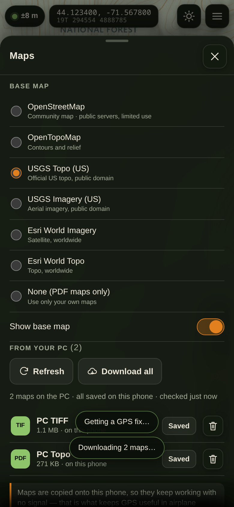
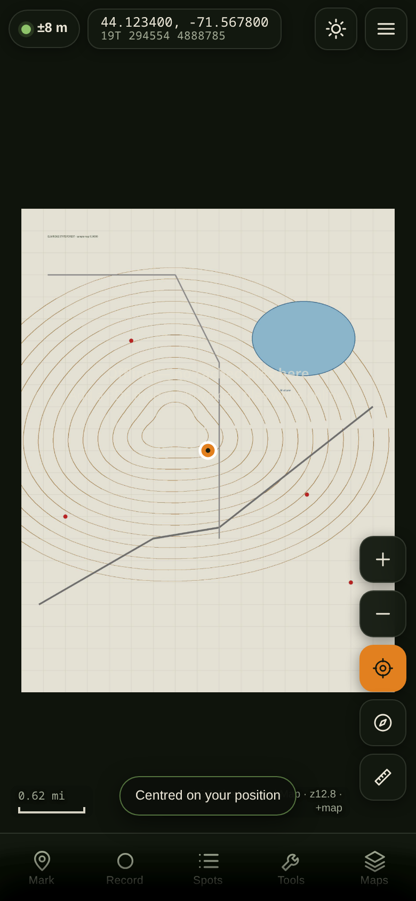
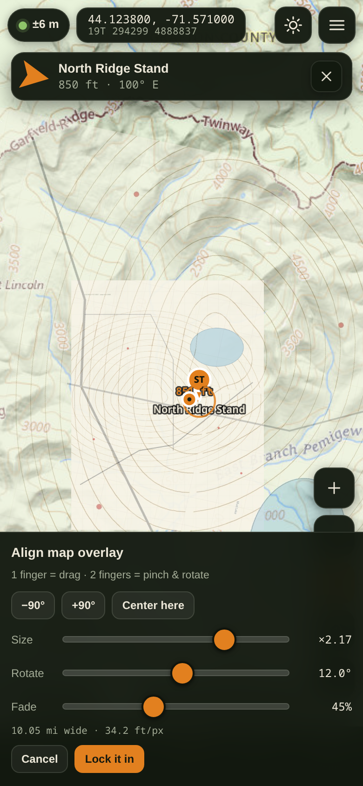
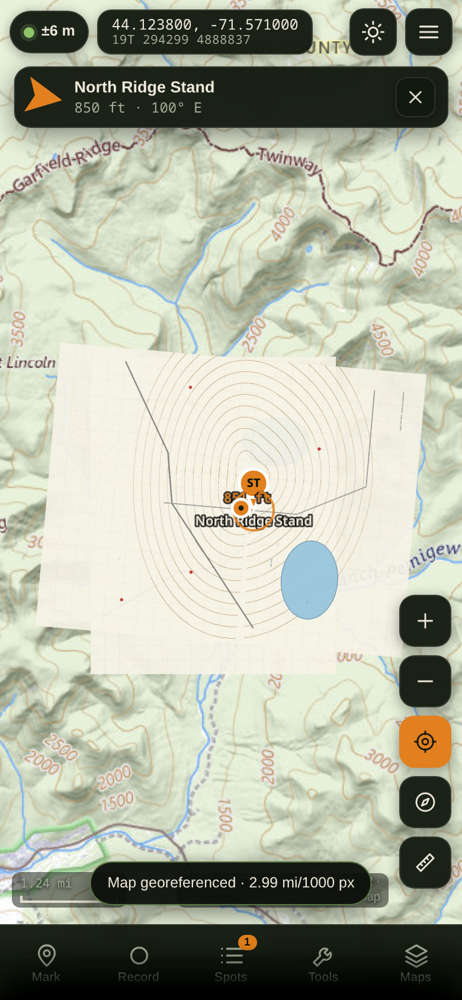

# HuntMap — offline GPS hunting map

A self-contained web app (HTML + JavaScript, no build step, no accounts, no server) for
scouting and hunting with your phone:

- **Live GPS** with accuracy circle, heading and a big "where am I" readout —
  phone GPS works in **airplane mode** because it only listens to satellites.
- **Your own maps**: load any **PDF**, **TIFF** scan or photo of a paper map, rotate it if the scan is
  sideways, georeference it with two control points, and use it as a map layer over the base map.
- **Maps from your PC** (optional): a small Django server keeps a map library on your computer;
  the phone lists it under *Maps → From your PC* and copies what it needs for offline use.
- **OpenStreetMap** and other raster base maps (USGS topo, USGS imagery, OpenTopoMap,
  Esri), cached for **offline** use.
- **Spots** (treestand, blind, trail cam, water, food plot, sign, kill site, camp,
  vehicle, hazard) with notes, bearings and distances.
- **Track recording** with distance, time, elevation gain and GPX export.
- **Sun & moon**: sunrise, sunset, civil twilight, legal-light window, moon phase, % lit.
- **Compass**, **distance measuring**, **go to coordinates**, UTM / DMS / decimal formats.
- **Works offline**: the app shell is cached by a service worker, PDFs and spots live in
  IndexedDB, map tiles you look at (or pre-download) are cached too.
- **Red night mode** for walking in before first light, plus a wake lock to keep the screen on.

Everything stays on the device. There is no backend, no telemetry and no upload of your maps
or locations.





---

## 1. Run it

### On a computer (quick look)

```bash
cd Hunting
python3 serve.py            # http://localhost:8080
```

Open <http://localhost:8080>. `localhost` counts as a secure context, so GPS and the service
worker work.

### On an iPhone / Android over your Wi-Fi

iOS only gives web pages GPS (and service workers) on **https://**. The included server can
create a self-signed certificate:

```bash
python3 serve.py --https    # prints the https://<your-lan-ip>:8080 address
```

On the phone:

1. Open the printed `https://192.168.x.x:8080` address in **Safari**.
2. Accept the certificate warning (**Show Details → visit this website → Continue**).
   To silence it permanently, AirDrop/email `.certs/cert.pem` to the phone, install the
   profile, then enable it under *Settings → General → About → Certificate Trust Settings*.
3. Tap **Share → Add to Home Screen**. Launch HuntMap from the home screen from now on.
4. Tap the crosshair button and allow location.

The phone must be on the same Wi-Fi as the computer while the server runs.

### Hosted (best for real use)

Upload the folder to any static HTTPS host — GitHub Pages, Netlify Drop, Cloudflare Pages,
your own web space. There is nothing to build or configure: `index.html` is the entry point.
Once the page has loaded once while online, the service worker keeps it available offline.

> **Important:** open the app from the *same* https address every time (that is what the
> home-screen icon does). Offline data (IndexedDB, cached tiles) belongs to that origin.

---

## 2. Maps from your PC (optional Django server)

The `server/` folder is a small **Django** project that serves this web app *and* keeps a
library of map files on the PC. On the phone they appear under **Maps → From your PC**, and one
tap copies them onto the phone. After that they live in the phone's storage, so they work with
no signal — which is what makes GPS useful in airplane mode.



### Set it up once

```bash
cd server
python3 -m pip install -r requirements.txt
python3 manage.py migrate
python3 manage.py createsuperuser     # login for /upload/ and /admin/
python3 serve.py                      # https://<your-lan-ip>:8443
```

`serve.py` serves **HTTPS** with a self-signed certificate from `server/.certs` (iOS only allows
GPS on https pages). Open the printed address on the phone, accept the certificate once, then
*Add to Home Screen*.

### Put maps on the PC

- **Web page** — open `https://<lan-ip>:8443/upload/`, log in, pick a PDF/TIFF/image, set the
  PDF page. The page lists the library with size and a *georeferenced: yes/no* badge.
- **Command line**, including whole folders:

  ```bash
  cd server
  python3 manage.py addmap ~/Maps/*.pdf
  python3 manage.py addmap ~/Maps/quad.tif --name "Elm Ridge 1:24000"
  ```

  Identical files are skipped, so re-running is safe.
- **Django admin** (`/admin/`) for renaming, replacing or deleting entries.

### Get them onto the phone

1. Phone on the same Wi-Fi as the PC.
2. **Maps → From your PC → Refresh** (it also loads when you open the Maps panel).
3. **Download** one, or **Download all**. Each map is rasterised on the phone (PDF page at up
   to 3000 px, TIFF decoded directly) and saved to IndexedDB.
4. The row turns green: *on this phone*. Changed files show *update available*; the trash
   button removes the local copy to free space.

**Georeference once, reuse everywhere:** align a downloaded map on the phone and the
calibration is uploaded to the PC (`PUT /api/maps/<id>/calibration`), so the next device that
downloads it arrives already placed. Georeferencing on the PC browser with a mouse works too
and is the easiest way to do it once.

### Airplane mode

| What the phone needs | Where it lives after a download |
| --- | --- |
| App, PDF engine, TIFF decoder | Service-worker cache (after the first visit) |
| Map image + georeference | IndexedDB on the phone |
| GPS | Satellite receiver — no network involved |

Routine: download the maps while on Wi-Fi → switch to airplane mode. The app opens, the maps
draw and the GPS dot moves (the first fix can take 30–120 s without network assistance).



### Server options and API

`server/serve.py` flags: `--http` (PC only — iOS blocks GPS on http LAN), `--port`, `--bind`,
`--no-migrate`.

| Environment variable | Meaning |
| --- | --- |
| `HUNTMAP_SECRET_KEY` | Django secret key (set it for anything permanent) |
| `HUNTMAP_HOSTS` | Allowed hosts, comma separated (default `*`) |
| `HUNTMAP_TOKEN` | If set, uploads and calibration writes require `X-HuntMap-Token` |
| `HUNTMAP_DB` | sqlite file (default `server/db.sqlite3`) |
| `HUNTMAP_MEDIA` | upload folder (default `server/media`) |
| `HUNTMAP_PROXY_SSL=1` | trust `X-Forwarded-Proto` behind nginx/caddy |
| `HUNTMAP_ORIGINS` | extra CSRF trusted origins |

API: `GET /api/maps/` (library), `POST /api/maps/` (multipart `file`, `name`, `page`),
`GET /api/maps/<id>/file`, `PUT /api/maps/<id>/calibration`.

The app is served from the same origin, so there is no CORS. Read endpoints are open to your
LAN — fine at home, not for the public internet; set `HUNTMAP_TOKEN` if you want writes
protected. Uploaded files stay in `server/media/`, outside the web app folder.

### Deploy with Docker / Portainer

The repo ships a `Dockerfile`, `docker-compose.yml` and a GitHub Actions workflow, so Portainer
can build it straight from your GitHub repo.

**Portainer → Stacks → Add stack → Repository**

| Field | Value |
| --- | --- |
| Repository URL | `https://github.com/<you>/<repo>` |
| Compose path | `docker-compose.yml` |
| Environment variables | `HUNTMAP_SECRET_KEY`, `HUNTMAP_ADMIN_PASSWORD` (see below) |

Press **Deploy the stack**. Portainer clones the repo, builds the image and starts one
container. Open `https://<docker-host>:8443/` — the certificate is self-signed, so accept it
once on each device, then *Add to Home Screen*.

| Variable | Default | Notes |
| --- | --- | --- |
| `HUNTMAP_SECRET_KEY` | placeholder | **Change it.** Any long random string. |
| `HUNTMAP_ADMIN_USER` / `HUNTMAP_ADMIN_PASSWORD` | `admin` / `huntmap` | Created on first start; `/upload/` and `/admin/` login. |
| `HUNTMAP_CERT_SAN` | `DNS:localhost,IP:127.0.0.1` | Add your address, e.g. `IP:192.168.1.50`. |
| `HUNTMAP_HOSTS` | `*` | Django `ALLOWED_HOSTS`, comma separated. Loopback stays allowed for health probes. |
| `HUNTMAP_PUBLISH_PORT` | `8443` | Host port in front of the container's 8443. |
| `HUNTMAP_HTTPS` | `1` | `0` = plain HTTP on 8000 (use behind your own TLS proxy or Cloudflare Tunnel). |
| `HUNTMAP_PROXY_SSL` / `HUNTMAP_FORWARDED_HOST` | off | Set to `1` behind Caddy/NPM/Traefik/Cloudflare. |
| `HUNTMAP_MAX_UPLOAD` | `314572800` (300 MB) | Largest accepted map file; Cloudflare allows 100 MB. |
| `HUNTMAP_TOKEN` | empty | If set, uploads and calibration writes need `X-HuntMap-Token`. |
| `HUNTMAP_WORKERS` / `HUNTMAP_THREADS` | `1` / `8` | One worker keeps SQLite happy; threads handle concurrency. |

Data lives in the named volume **`huntmap-data`** (`/data` inside the container; Portainer prefixes
it with the stack name, e.g. `huntmap_huntmap-data`): `db.sqlite3`, uploaded maps in `media/`, and
the TLS certificate in `certs/`. Portainer can browse, back up and restore that volume from
*Volumes*.

**Automatic updates (optional).** Push the repo to GitHub and the workflow in
`.github/workflows/docker.yml` builds a multi-arch image and publishes it to
`ghcr.io/<owner>/<repo>:latest`. Then:

1. In Portainer, add `docker-compose.ghcr.yml` as the stack instead, with
   `HUNTMAP_IMAGE=ghcr.io/<owner>/<repo>:latest` (make the GHCR package public, or add
   `ghcr.io` as a registry in Portainer).
2. In the stack, enable **GitOps updates → Webhook**, copy the URL, and add it to the GitHub
   repo as a webhook (Settings → Webhooks). Every push then redeploys the stack.
   Optionally set **Polling** instead of a webhook.

**Certificate reality check.** Self-signed HTTPS is fine for opening the app and using GPS, but
**service workers (offline mode) need a certificate the browser trusts**. With a self-signed
cert that you only clicked through, Chrome may refuse to register it and iOS behaves
inconsistently. For dependable offline use, do one of these:

- use a proxy with a real certificate (Caddy, Nginx Proxy Manager, Traefik) and run the
  container with `HUNTMAP_HTTPS=0` + `HUNTMAP_PROXY_SSL=1` + `HUNTMAP_FORWARDED_HOST=1` on
  port 8000, or
- install the self-signed certificate as trusted on the phone
  (*Settings → General → About → Certificate Trust Settings*), or
- import your own certificate into the volume at `/data/certs/cert.pem` + `key.pem`
  (e.g. from your internal CA) and restart the container.

#### Behind a Cloudflare Tunnel (real certificate, no warnings)

A tunnel is the cleanest way to get a *trusted* certificate: Cloudflare terminates TLS, so the
service worker registers normally, the phone shows no warning, and the library is reachable even
when you are not at home. The repo ships `docker-compose.cloudflare.yml`, which runs the app plus
a `cloudflared` sidecar on an internal network — no ports are published.

1. **Cloudflare → Zero Trust → Networks → Tunnels → Create a tunnel → Cloudflared → Docker** and
   copy the token from the shown command.
2. **Public hostname** for that tunnel:

   | Field | Value |
   | --- | --- |
   | Subdomain / Domain | `huntmap` / `example.com` |
   | Service | `HTTP` → `huntmap:8000` |

3. **Portainer → Stacks → Add stack → Repository**, compose path `docker-compose.cloudflare.yml`,
   environment:

   ```
   CLOUDFLARE_TUNNEL_TOKEN=<token from step 1>
   HUNTMAP_SECRET_KEY=<long random string>
   HUNTMAP_ADMIN_PASSWORD=<your login>
   HUNTMAP_HOSTS=huntmap.example.com
   HUNTMAP_ORIGINS=https://huntmap.example.com
   ```

4. Open `https://huntmap.example.com/` — padlock, no click-through, then *Add to Home Screen*.

Already running `cloudflared` in another stack? Put both containers on a shared network and point
the public hostname at `http://huntmap:8000`:

```bash
docker network create huntmap-net      # add it to the huntmap and cloudflared services
```

The stack sets what a TLS-terminating proxy needs:

| Setting | Value | Why |
| --- | --- | --- |
| `HUNTMAP_HTTPS` | `0` | Cloudflare does TLS; gunicorn speaks plain HTTP. |
| `HUNTMAP_PORT` | `8000` | Port gunicorn binds (and the healthcheck probes). |
| `HUNTMAP_PROXY_SSL` | `1` | Trust `X-Forwarded-Proto: https`, else Django thinks the request is http. |
| `HUNTMAP_FORWARDED_HOST` | `1` | Trust `X-Forwarded-Host`, so `file_url` in the API carries the public name. |
| `HUNTMAP_HOSTS` | `huntmap.example.com` | Pins `ALLOWED_HOSTS`; `127.0.0.1`/`localhost` stay allowed for the healthcheck. |
| `HUNTMAP_MAX_UPLOAD` | `95000000` | Cloudflare accepts at most 100 MB per request (Free/Pro/Business). |

Cloudflare dashboard settings that matter:

- **Always Use HTTPS: on.** The zone's SSL/TLS mode does not apply — with a tunnel, Cloudflare
  never connects to your origin directly.
- **Rocket Loader: off** — it rewrites scripts and can break the app.
- **Bot Fight Mode: off** for this hostname (or a WAF skip rule) — browser challenges make the
  app's `fetch()` calls fail instead of returning data.
- **Cache rule: bypass for `/api/*` and `/sw.js`** so downloads and app updates are never stale.
- **Cloudflare Access (recommended).** `GET /api/maps/` and the file downloads are unauthenticated
  — anyone with the hostname can pull your maps. Access puts an email/SSO login in front of the
  whole thing. Trade-off: when the Access session expires, the installed app's sync requests get
  the login page instead of data (offline use and GPS are unaffected). Use a long session
  (*Access → Applications → Session duration*, e.g. 1 month), or skip Access and rely on
  `HUNTMAP_TOKEN` for writes plus an unguessable hostname for reads.
- **Uploads over 100 MB** are rejected by Cloudflare. Temporarily add `ports: ["8000:8000"]` to the
  stack and upload from a machine on your LAN, or export a smaller scan.

**Command line equivalent**

```bash
docker compose up -d --build          # build from this folder
docker logs -f huntmap                # watch migrate + gunicorn
docker exec -it huntmap python manage.py changepassword admin
docker cp ~/Maps/quad.tif huntmap:/tmp/quad.tif
docker exec -it huntmap python manage.py addmap /tmp/quad.tif --name "Elm Ridge 1:24000"
```

`GET /api/health/` is a small JSON probe (used by the container healthcheck).

---

## 3. First five minutes in the woods

| Button | What it does |
| --- | --- |
| **Mark** | Save the current GPS position as a spot (type, name, notes). |
| **Record** | Start/stop a GPS track. Keep the app open while recording. |
| **Spots** | List, search, edit, navigate to, share, GPX export/import. |
| **Tools** | Sun & moon, compass, tracks, go-to coordinates, GPS details, backup, settings. |
| **Maps** | Base map choice, your PDF maps, offline tile download. |

Other gestures:

- **Tap the map** → coordinates under your finger appear in the top chip; tapping a pin
  opens that spot.
- **Long-press the map** → drop a new spot exactly there (handy for a rub or scrape seen on
  a photo map).
- **Pinch / drag** → zoom and pan. **Double-tap** zooms in.
- **Tap the coordinate chip** → cycle decimal ↔ deg/min/sec ↔ UTM.
- **Tap the GPS chip** → GPS details and a restart button.

---

## 4. Adding a PDF, TIFF or paper map (the useful part)

### 4a. Get the file onto the phone

Put the file in **Files** (AirDrop, iCloud, email, download). Supported:

| Format | Notes |
| --- | --- |
| **PDF** | Multi-page: pick the page. Rendered by pdf.js on the device. |
| **TIFF / TIF** | Any compression (uncompressed, LZW, PackBits, JPEG, Deflate). Multi-page TIFF uses the first page. Decoded by UTIF on the device. |
| JPEG / PNG / HEIC / WebP | Photos of maps, phone screenshots, exported images. |

Nothing is uploaded — everything is converted on the device.

### 4b. Load it

**Maps → Add PDF or image → Choose file** → pick the page (PDF only) and resolution → **Load map**.

Resolution: 2000 px is fast, 3000 px is the default and fine for most 1:24,000 quads,
4000 px is sharpest but slower and uses more memory.

Very large TIFFs (over ~70 megapixels) are refused — resize them to about 3000 px first
(Preview/Photos export, or `magick big.tif -resize 3000x3000\> map.jpg`). Converting a TIFF to
PNG/JPEG is also a good idea if you want to save storage space.

### 4c. Rotate it if the scan is sideways

After the image loads you get a **Rotate image** row:

- **↺ 90° / ↻ 90°** — turn a landscape scan into portrait, or fix a scan that came in sideways.
- **180°** — upside-down scan.
- The current angle is shown next to the buttons; every click re-renders from the original, so
  rotating back and forth never degrades the image.

Then, when georeferencing, two more rotation tools are available:

- **Fine rotation** slider (±15°, 0.5° steps) in the control-point sheet — fixes a scan that is
  a few degrees crooked, without needing to redraw it.
- **±90°** buttons (and two-finger **twist**) for a quick quarter turn, plus **Size**, **Rotate** and
  **Fade** sliders in the *align on map* view. The sliders are logarithmic, so a nudge near ×1.00
  moves the overlay by a few pixels, and the line under them reads out the overlay's real width
  and scale (`4.2 mi wide · 12.3 ft/px`) — handy for matching a paper map exactly.





### 4d. Georeference it — two ways

**A. Two control points (most accurate)**

1. Tap **Enter 2 control points**.
2. Tap a landmark on the image (a section corner, road junction, summit, lake point).
3. Type its real coordinates — anything readable works:
   `44.1234, -71.5678` · `44 07 24 N 71 33 12 W` · `19T 294554 4888785`
4. Repeat for a second landmark **far away** from the first — the further apart, the better.
5. Leave **North-up map** on (paper maps usually are), add **Fine rotation** if the scan is
   skewed, then press **Apply georeference**.

**B. Place & align on the map**

1. Tap **Place & align on map**. The overlay appears at the current map view.
2. Drag with one finger, pinch/twist with two to line it up with roads, ridges and water.
3. Use *Bigger / Smaller / ±90° / ±1° / ±10°* and the opacity slider to fine-tune, then
   **Lock it in**.

If you know the **paper scale** (1:24,000, 1:50,000 …), choose it before loading — the overlay
starts at the right size, which makes aligning much faster. For TIFFs the app reads the scan
resolution (DPI) tag when present, so 1:24,000 scans also come in at the right size.

After calibration a layer can be toggled, faded, re-aligned or removed in **Maps**. Its
position is stored with the layer, so it loads in the right place next time.

### Accuracy tips

- Two points 1–3 km apart give a good result; 100 m apart will be noticeably off.
- Phone GPS is typically 3–10 m, sometimes 30 m under canopy. Do not use this for property
  boundaries or legal descriptions.
- An already-georeferenced **GeoPDF** still has to be calibrated this way — the app reads the
  printed image, not the embedded projection.

---

## 5. Offline use

| Data | Where it lives | Works in airplane mode |
| --- | --- | --- |
| App (HTML/JS/CSS/PDF engine) | Service worker cache | Yes, after one online load |
| Spots, tracks, settings, map calibration | IndexedDB | Yes |
| PDF/page images | IndexedDB (as PNG/JPEG) | Yes |
| Base map tiles | Cache API | Only tiles already viewed or downloaded |

**Before you lose signal:** open **Maps**, zoom to the area you will hunt, set the zoom range
(e.g. 12 → 16) and press **Download view**. The app estimates the tile count first and refuses
huge jobs. A 4 × 6 km area at z12–16 is roughly 400 tiles / 10 MB.

**Airplane-mode reality check:** GPS keeps working, but the first fix can take 30–120 seconds
because the phone cannot use network assistance. Hold it under open sky. Compass heading comes
from the magnetometer and is independent of the network.

**Keep the screen on:** *Tools → Keep screen awake* uses the Wake Lock API where supported
(iOS 16.4+, Chrome). If it is unavailable, raise *Settings → Display → Auto-Lock* instead.

---

## 6. Tile providers and their rules

| Provider | Notes |
| --- | --- |
| **USGS Topo / Imagery (US)** | Public domain. Default in North America. Best choice for offline hunting use in the US. |
| **OpenStreetMap** | Community servers. Fine for normal viewing; **bulk downloading is against their tile usage policy**. |
| **OpenTopoMap** | Community, CC-BY-SA, contour lines, max zoom 17. |
| **Esri World Imagery / Topo** | Free for light use; check Esri's terms before caching large areas. |

The app sends a normal browser request, shows the required attribution, and keeps downloads
small (hard limit 2,500 tiles per job, ~4 concurrent requests, polite delay). If a provider
refuses a request (HTTP 403/429) the app says so instead of drawing the error image.

For big offline areas the right answer is **your own PDF maps** (unlimited, precise, no
policy issues) — that is why the PDF workflow exists.

---

## 7. Backup, import and moving data

- **Tools → Backup → Download backup (JSON)** — spots, tracks, map calibration and settings.
  The images themselves are not included; keep the original PDF/TIFF files.
- **Restore backup** replaces the data on the device.
- **GPX export/import** — spots and tracks interoperate with Garmin, onX, Gaia, CalTopo, etc.
- **Erase app data** wipes everything, including cached tiles.

---

## 8. Settings worth knowing

| Setting | Effect |
| --- | --- |
| Units | Feet/miles or metres/km everywhere (distances, elevations, speeds). |
| Coordinates | Decimal degrees, deg/min/sec or UTM in the HUD and lists. |
| Red night mode | Black/red UI and dimmed map — preserves night vision. |
| Keep screen awake | Wake lock while the app is open. |
| High-accuracy GPS | Uses the precise GPS chip rather than coarse/network fixes. |
| Waypoint labels | Names next to pins on the map. |
| Lat/lon grid | Graticule with degree labels. |
| Show tracks on map | Hide old tracks for a cleaner map. |

---

## 9. Project layout

```
index.html                 app shell, panels, icon sprite
manifest.webmanifest       PWA metadata (name, icons, standalone)
sw.js                      service worker: app-shell offline cache
css/app.css                theme, sheets, night mode, touch layout
js/util.js                 DOM helpers, formatting, toasts, modal dialogs
js/geo.js                  Mercator projection, haversine, UTM, coordinate parsing
js/sun.js                  NOAA sunrise/sunset/twilight, Meeus moon phase
js/db.js                   IndexedDB wrapper (+ in-memory fallback)
js/tiles.js                tile providers, Cache-API tile store, area downloader
js/map.js                  canvas map renderer, gestures, overlays, tracks, pins
js/gps.js                  geolocation watch, smoothing, compass, wake lock
js/data.js                 spots, tracks, layers, GPX, backup/restore
js/pdfmap.js               pdf.js/TIFF rendering, image rotation, calibration math
js/sync.js                 optional bridge to the Django server (PC map library)
js/app.js                  all UI wiring
vendor/pdfjs/              pdf.js 3.11.174 (legacy UMD build, Apache-2.0)
vendor/utif/               UTIF 3.1.0 TIFF decoder (MIT)
vendor/pako/               pako 2.1.0 zlib for Deflate TIFFs (MIT)
serve.py                   local HTTP/HTTPS server for the static app
Dockerfile                 container image: app + Django, HTTPS, healthcheck
docker-compose.yml         Portainer/compose stack (builds from this repo)
docker-compose.ghcr.yml    stack for the prebuilt GHCR image
docker-compose.cloudflare.yml  stack for Cloudflare Tunnel (app + cloudflared, no TLS inside)
.github/workflows/docker.yml  builds + publishes the image on push
server/                    optional Django server: library, upload page, sync API
  manage.py                migrate, createsuperuser, addmap, ensureadmin, runserver
  serve.py                 HTTPS runner for the LAN (self-signed cert)
  docker-entrypoint.sh     migrate + admin + gunicorn (TLS) on container start
  healthcheck.py           container health probe
  huntmap_server/          settings + urls
  maps/                    model, admin, API views, /upload/ page, addmap command
tests/e2e.py               Playwright: standalone app (no server)
tests/e2e_django.py        Playwright: PC sync + airplane mode
tests/sample-topo-map.pdf  sample PDF map for trying the import workflow
tests/sample-topo-map.tif  sample TIFF map (LZW compressed)
```

Debug handles on `window.Hunt`: `Geo`, `Sun`, `DB`, `Tiles`, `MapView`, `GPS`, `Data`,
`PDFMap`, `Sync`, `App` (and `Hunt.App.map`, the live map instance).

---

## 10. Tests

```bash
python3 -m pip install playwright
python3 -m playwright install chromium
python3 tests/e2e.py            # standalone app
python3 tests/e2e_django.py     # Django server: download + airplane mode
python3 tests/e2e_docker.sh     # the built container: health, upload, volume restart

cd server && python3 manage.py test maps    # server/API unit tests
```

`tests/e2e.py` (47 checks): load without errors, GPS fix, HUD coordinates/UTM, waypoint save +
persistence, navigation bar, sun/moon panel, the built-in self-test, PDF open/rasterise, adding
a PDF through the real UI (file picker → rasterise → tap two control points → apply), north-up
georeferencing, overlay pixels on the canvas, track recording while moving, GPX round-trip,
reload persistence, service worker, a full **offline reload**, a **TIFF** map loaded through the
UI, rotated 90°, georeferenced with a 5° fine rotation, and the align-bar sliders.

`tests/e2e_django.py` (13 checks): Django serves the app, the PC library is listed, PDF + TIFF
downloaded and stored, the phone's georeference is uploaded to the PC, then with the network
**off**: the app opens, both maps survive with their images, GPS reports a fix and the
georeferenced map renders from storage. A second, fresh phone downloads the map and starts with
the PC's georeference.

`server/maps/tests.py` (15 tests): app files served and private files hidden, health endpoint
(including loopback probes with a pinned host name), upload/list/download, MIME types, sha256,
calibration validation, token protection, login requirement, the upload form, `addmap` idempotency.

`tests/e2e_docker.sh` (21 checks, two container modes): builds the image, starts the HTTPS
container, waits for Docker's healthcheck, verifies the app shell + `/api/health/` + static assets,
that private files are hidden and `/upload/` needs a login, uploads a map through the API,
downloads it again, restarts and confirms map + admin survived the volume; then starts a second
container in "TLS terminated upstream" mode (pinned host name, `X-Forwarded-Proto/Host`) and checks
it goes healthy, serves plain HTTP, accepts an upload and returns `file_url` on the public origin.

There is also an in-app self-test: **Tools → Run self-test** (geometry, UTM, sun, GPX,
storage, PDF engine, TIFF decoder, calibration rotation).

---

## 11. Known limitations

- iOS pauses web pages in the background; tracks only record while the app is open and the
  screen is on. There is no background GPS for web apps.
- Phone GPS accuracy is 3–30 m and can be much worse under heavy canopy or in canyons.
- Two-point calibration assumes a locally uniform scale and (optionally) north-up; very large
  or oblique scans may need the drag-align method plus manual rotation.
- TIFF: only the first page of a multi-page file is used, files above ~70 megapixels are refused
  (resize first), and decoding a big TIFF takes a few seconds on older phones.
- No property boundaries, no legal descriptions, no emergency/SOS service. Carry a compass
  and paper map as backup, and follow your local hunting regulations.
- PDF rendering needs pdf.js from `vendor/pdfjs/` and TIFF needs `vendor/utif/` (+ `vendor/pako/`
  for Deflate). If one is missing only that format is disabled; everything else still works.
- Tile providers can refuse traffic (403) or change URLs at any time; the app reports it.
- The Django server is meant for a home LAN: no accounts on the phone side, and `serve.py` uses
  Python's built-in WSGI server (fine for a few devices). For anything permanent, run it under
  gunicorn/uvicorn behind nginx or Caddy with a real certificate.
- Downloaded maps are stored per browser origin. If you switch from `http://localhost` to
  `https://192.168.x.x`, the phone starts with an empty library until you download again.
- Offline mode needs a **trusted** certificate (service workers refuse untrusted origins).
  The container's self-signed cert works for GPS and the app, but for reliable offline caching
  put it behind a proxy with a real certificate, or install the cert on the phone.

---

## 12. Credits

- Map data © OpenStreetMap contributors (ODbL), OpenTopoMap (CC-BY-SA), USGS The National Map
  (public domain), Esri (see Esri terms).
- PDF rendering: Mozilla **pdf.js** 3.11.174, Apache-2.0 (`vendor/pdfjs/LICENSE`).
- TIFF decoding: **UTIF.js** 3.1.0, MIT (`vendor/utif/LICENSE`); Deflate support via
  **pako** 2.1.0, MIT (`vendor/pako/LICENSE`).
- Sun/moon algorithms: NOAA solar position equations and Meeus lunar longitude terms.
- Server: **Django** (BSD licence). `server/serve.py` only uses Python's standard library.
- Icons are generated locally; the UI has no external fonts or scripts.


